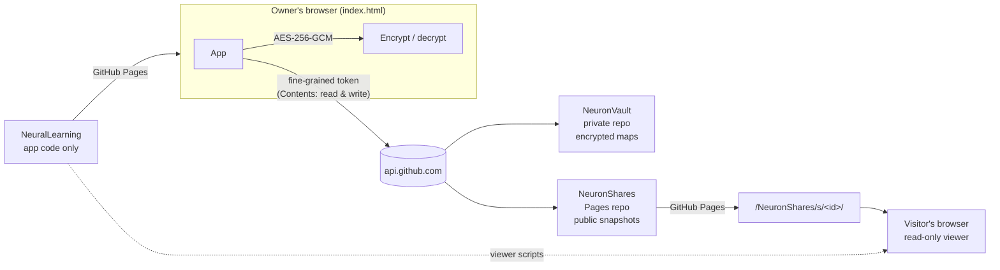

# Neuron — Knowledge Graph Builder

Neuron turns any topic into an interactive knowledge graph: concepts placed by meaning, the
connections between them, prerequisites, and a learning path. You generate a prompt, paste it into
any AI assistant, paste the JSON answer back, and explore the map.

- **App (owner):** https://hhrishikeshh.github.io/NeuralLearning/
- **Shared maps (public, read-only):** `https://hhrishikeshh.github.io/NeuronShares/s/<id>/`

Neuron has **no backend**. GitHub Pages hosts it, GitHub repositories store the data, and all
encryption happens in the browser with the Web Crypto API.

---

## How it works



| Repository | Visibility | Pages | Contains | Token access |
|---|---|---|---|---|
| `NeuralLearning` | public | yes | application code only | **none** |
| `NeuronVault` | private | no | `keyring.json`, `manifest.enc`, `maps/<id>.enc` | Contents R/W |
| `NeuronShares` | public (or private + Pages on GitHub Pro) | yes | `s/<id>/index.html`, `map.json`, `og.*` | Contents R/W |

### Owner flow
1. **Unlock**: on a new device, paste your GitHub token and enter your vault passphrase. After
   that the device remembers the token, encrypted with your passphrase, so you only type the
   passphrase.
2. **My maps**: search, sort, open, rename, export, delete and share.
3. **New map**: topic and depth → copy the prompt into any AI → paste the JSON → validate →
   visualise → **Save**. The number of AI responses follows the depth, so each one fits within
   free models' output limits: **Explorer 1** (one complete map), **Practitioner 2** (skeleton,
   then one data part with every explanation), **Researcher 3** (skeleton, then Data Part 1 and
   Data Part 2). The multi-part screens show a `1/2 complete`-style progress badge and have two
   modes: **Generate with AI** (prompts one after another; the graph can be visualised after the
   skeleton and filled in later via ← Build) and **Paste existing responses** (paste all parts in any
   order; Neuron validates each one, cross-checks them, and renders only a complete, valid map).
   "Already have JSON?" opens the inputs for the selected depth.
4. **Share**: an explicit action with a consent step. It publishes a separate public snapshot.
5. The vault **auto-locks** after 15 minutes without activity. **Lock** is in the header.

### Visitor flow
A shared link opens a dedicated read-only viewer: an intro card, the graph, concept details,
the learning path (with "walk the path"), and insights. No sign-in, no library, no editing.

---

## Security model

Be precise about what is protected and how:

| Protection | Mechanism | Strength |
|---|---|---|
| Map contents, titles, topics, dates, progress | AES-256-GCM in the browser before upload | **Cryptographic**: unreadable without the passphrase or recovery code |
| Files swapped, moved or tampered with | AES-GCM authentication with the file path bound as AAD | **Cryptographic**: decryption fails loudly |
| Who can write to the vault and shares | A GitHub fine-grained token scoped to those two repos | **Enforced by GitHub** |
| App code integrity | The token has no access to `NeuralLearning` | **Enforced by GitHub** |
| Viewers seeing other maps | The viewer has no vault, crypto or GitHub code and fetches one snapshot | **Structural**: there is nothing else to fetch |
| Overwriting newer data | Every save is one commit with a fast-forward-only ref update; conflicts re-read and retry | **Enforced by GitHub** |
| Map JSON as an attack vector | Strict validation, size limits, hex-only colours, text-only rendering, CSP | Defence in depth |
| Hiding the creation screens from visitors | The UI only shows them after unlock | **UI only**. Anyone can download the HTML and generate maps locally, but they cannot save or publish to *your* repositories. |

**Key handling.** Your passphrase goes through PBKDF2-SHA-256 (1,000,000 iterations, random
salt) to produce a key that unwraps a random 256-bit vault key. That key lives in memory only, is
non-extractable, and is dropped when the vault locks. A separate random **recovery code**
(shown once at setup) wraps the same key. The passphrase is never stored. The GitHub token is
held in memory, or optionally stored on a device **encrypted with your passphrase**.

**Honest limits.**
- The vault is only as strong as your passphrase. Neuron enforces 16+ characters or a phrase of
  4+ words. PBKDF2 can be brute-forced on GPUs if the passphrase is weak.
- **Shared maps are public.** Anyone with the link can view, copy and download them.
  Unpublishing removes the page but cannot recall copies, and the snapshot remains in the shares
  repository's git history. If `NeuronShares` is a public repository, anyone browsing it can list
  every shared map; random IDs only prevent guessing. A private repository with Pages (GitHub
  Pro or higher) keeps links unlisted.
- Everything served from `hhrishikeshh.github.io` shares one browser origin, including any other
  Pages sites on this account. A script injected into any of them during an unlocked session could
  use the token. Neuron mitigates this with a strict Content-Security-Policy, no inline scripts,
  SRI on D3, text-only rendering, and auto-lock. A custom domain for the app would give it its own
  origin.
- Google Sign-In is **not** used. In a static site it can show who you are, but it cannot authorise
  GitHub writes without a server that holds a GitHub secret. GitHub's own OAuth and device-flow
  endpoints do not allow browser (CORS) requests, so they also need a server.
- Token expiry cannot be read from the browser (GitHub doesn't expose the header to CORS). When the
  token expires, Neuron shows "token rejected" and asks for a new one.
- GitHub Pages cannot send frame-blocking headers, so the owner app refuses to run inside a frame.

---

## Owner setup (one time)

1. **Merge this branch and point Pages at it.** In `NeuralLearning` → Settings → Pages, set the source
   to the branch you deploy (`main`, folder `/`).
2. **Create `NeuronVault`**: private, "Add a README" ticked, Pages off.
3. **Create `NeuronShares`**: public (or private if you have GitHub Pro), "Add a README" ticked.
   Settings → Pages → Deploy from a branch → `main` / root.
4. **Create a fine-grained token**: GitHub → Settings → Developer settings → Personal access tokens
   → Fine-grained tokens → Generate new token.
   - Expiration: 90 days (recommended).
   - Repository access: **Only select repositories → `NeuronVault` and `NeuronShares`**.
   - Repository permissions: **Contents: Read and write** (Metadata: Read-only is added automatically).
     Nothing else.
   - Never grant it access to `NeuralLearning`. Paste it only into the Neuron unlock screen.
5. Open the app, paste the token, choose a passphrase, and **store the recovery code** somewhere safe
   (a password manager or paper; not in any repository).

Nothing else is needed: no OAuth apps, client secrets, Actions or third-party services.

**Rotating the token:** create a new token with the same settings, revoke the old one, then choose
"Use a different token" on the unlock screen of each device.

---

## Backup and recovery

- **Settings → Download encrypted backup** saves one JSON file holding the keyring, index and every
  map, all still encrypted. It's safe to keep anywhere.
- **Settings → Import a backup** merges by map ID: maps that are missing or older here are added or
  updated, and newer local maps are never replaced. A backup from a different vault asks for that
  vault's passphrase.
- **Lost the vault repository?** Create an empty `NeuronVault`, unlock, and choose
  **Restore from a backup file** on the setup screen.
- **Forgot the passphrase?** Unlock screen → *Forgot passphrase?* → paste the token and the recovery
  code, then set a new passphrase.
- **Deleted a map by mistake?** Deletions are commits in your private vault. The previous encrypted
  file stays in git history. Restore `maps/<id>.enc` and `manifest.enc` from an earlier commit on
  GitHub, or import an older backup.
- **Interrupted publish or unpublish?** Neuron reconciles half-finished shares on the next unlock.

---

## Local development

ES modules need an HTTP server (opening the file directly will not work):

```bash
python3 tests/serve.py 8000
```

Then open:

- `http://127.0.0.1:8000/` for the owner app (talks to the real GitHub API)
- `http://127.0.0.1:8000/tests/e2e.html` for the **owner app against an in-browser fake GitHub**
  (no real repositories or tokens). Token: `github_pat_TESTTOKEN0123456789abcdef` (the only one the
  fake accepts), passphrase: `e2e river ember cloud tide` (see `tests/e2e-boot.js`). Reset it
  with `__resetFake()` in the console. It refuses to run anywhere but localhost.
- `http://127.0.0.1:8000/view.html?s=TestShareId0000000000A` for the viewer with a sample share
  (`MaliciousShare0000000B` loads an XSS test fixture)

Run the tests (Node 22+). The unit and integration tests need no dependencies:

```bash
node --test tests/
```

The syntax check and the browser tests use the dev tooling in `package.json` (Playwright only;
the app itself has no runtime dependencies):

```bash
npm ci
npx playwright install chromium
npm run check      # every .js / .mjs file parses
npm test           # same as node --test tests/
npm run test:e2e   # e2e/*.spec.mjs: the owner app against the fake GitHub, plus the viewer
```

They cover NCF/legacy parsing and validation, malicious input, encryption (tampering, AAD, IV
uniqueness, wrong secrets, passphrase change, recovery), the vault against a fake GitHub
(concurrent devices, conflicts, partial failures, rate limits, large files, backup/restore), and
sharing (escaping, publish, unpublish, reconcile).

`tests/render-og.html` regenerates `assets/og-default.jpg` (screenshot it at 1200×630).

---

## Continuous integration

`.github/workflows/ci.yml` runs on every pull request to `main` and every push to `main`:

| Check | What it runs |
|---|---|
| `unit (22)`, `unit (24)`, `unit (26)` | `npm ci`, `npm run check`, `npm test` on each Node version |
| `e2e` | `npm ci`, Playwright Chromium, `npm run test:e2e` |

- **No secrets.** CI never sees the Neuron GitHub token. The vault and sharing tests run against
  in-memory and in-browser fakes of the GitHub API. The browser tests also abort any request to
  the real `api.github.com` or `hhrishikeshh.github.io` and fail if one is attempted. The workflow
  token is read-only (`contents: read`), checkout does not keep credentials, and it uses
  `pull_request` (not `pull_request_target`), so code from a pull request never runs with
  privileges.
- Actions are first-party and pinned to full commit SHAs. Dependencies install from
  `package-lock.json` with install scripts disabled.
- **Results:** the pull request's *Checks* section, or the repository's *Actions* tab. When `e2e`
  fails, download the `playwright-report` artifact from the run and open `index.html`, or run
  `npx playwright show-trace` on a trace inside it.
- **The browser tests use the network** for D3 (loaded from cdnjs with SRI, as in production).
  Fonts are blocked in tests. CI retries a failed browser test once.

**Make the checks required before merging** (manual, one time): repository **Settings → Rules →
Rulesets → New ruleset → New branch ruleset**. Name it, set *Enforcement status* to **Active**,
add the target **Include default branch**, tick **Require status checks to pass**, add `unit (22)`,
`unit (24)`, `unit (26)` and `e2e` (they appear after the workflow has run once), and optionally
tick **Require a pull request before merging**. Save. On the older page (**Settings → Branches →
Add branch protection rule** for `main`), the same options are under "Require status checks to pass
before merging".

---

## Project structure

```
index.html                 owner app shell (strict CSP)
view.html                  fallback viewer: view.html?s=<shareId>
neuron-app.html            redirect for old links
manifest.webmanifest, assets/
css/  tokens.css (type scale, colours)  base.css  mapview.css  app.css  viewer.css
js/config.js               public config: repo names and URLs (no secrets)
js/core/                   ncf.js (parse/validate/sanitise)  prompts.js  dom.js  b64.js  stars.js
js/graph/                  engine.js (D3 force graph)  mapview.js (map screen, owner + viewer)
js/viewer/viewer.js        public read-only viewer (imports no owner code)
js/owner/                  app.js (router)  session.js  crypto.js  github.js  vault.js
                           shares.js  share-page.js  og-image.js  ui.js  screens/*.js
tests/                     node tests, fake GitHub, e2e harness, fixtures
e2e/                       Playwright browser tests (run against tests/e2e.html)
scripts/check-syntax.mjs   syntax check used by CI
.github/workflows/ci.yml   CI: unit tests on Node 22/24/26, browser tests
```

## Data formats

- **Map JSON:** NCF (`_ncf: "1"`, columnar `N`/`L`/`LP`) or the legacy verbose format. Both are
  accepted everywhere (see "View expected JSON schema" in the app). Exports use NCF.
- **Encrypted file:** `{"neuron":"enc","v":1,"alg":"A256GCM","z":"gzip","iv":…,"ct":…}`. The
  plaintext is gzip-compressed JSON, and the AAD is `neuron:v1:<logical path>`. The version
  field allows future upgrades (for example Argon2id).
- **Shared snapshot:** `{"neuronShare":1,"publishedAt":…,"updatedAt":…,"title":…,"map":<NCF>}`.
  It holds no owner progress, vault IDs or other metadata.

## Navigating a map

Drag to pan, scroll or pinch to zoom, hover to preview, and click a concept to focus it and open
its details. Press `/` to search and `Esc` to clear. The **Domains** list highlights a category.
The **Learning path** tab lists the steps, with Prev/Next to walk through them; owners can tick
steps off, and progress syncs to the vault. **Insights** shows cross-domain insights, common
misconceptions and suggested next topics.
